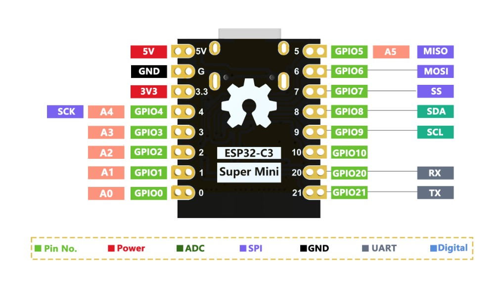

# ESP32-C3 Super Mini 引脚

下图由用户提供（2026-10-17），USB 接口朝上，按板上 GPIO 丝印接线。

| 图中引脚 | 工程用途 |
| --- | --- |
| GPIO4（左侧 4，A4/SCK） | 阀门驱动输入，高有效，外部下拉 |
| GPIO5（右上 5，A5/MISO） | 流量计 3.3V 脉冲，下降沿 |
| GPIO6（右侧 6，MOSI） | 联锁输入，3.3V HIGH 许可，外部下拉 |
| GPIO20 / GPIO21 | UART0 RX / TX，当前维护入口未使用 |
| USB 接口 | 下载、启动日志、USB 维护命令；底层 GPIO18/19 |
| 5V / 3V3 / GND | 供电和参考地；不是阀门功率驱动输出 |

板上 SPI/I2C 标注是复用功能，本工程没有同时启用图中 SPI/I2C；4/5/6 在本工程按普通 GPIO 使用。GPIO8/9 涉及板载 LED、BOOT/启动配置，未选作驱动信号。GPIO2 也是启动配置相关脚，本工程未使用。阀门和传感器的外部电源、驱动与电平需按实际设备规格连接。

仅受控台架且未接真实联锁时，可将 GPIO6 接 3V3 表示许可；这不提供真实联锁保护。不要照搬历史 ESP32 从机 GPIO32 跳线，也不要接 5V 到 GPIO6。默认 commissioned=false，编译成功不等于现场输出已启用。
